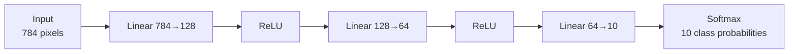

# MNIST Neural Network from Scratch

A small feedforward neural network built with **only NumPy**: no PyTorch, no Keras layers, no autograd. It learns to recognize handwritten digits from the MNIST dataset, and a Tkinter app lets you draw a digit and watch the model guess it.

TensorFlow is used for one thing only: downloading the MNIST dataset.

| | |
|---|---|
| **Test accuracy** | ~97.5% |
| **Validation accuracy** | ~98.0% |
| **Training time** | about 1 minute on a modern laptop CPU |
| **Parameters** | 109,386 |

---

## Contents

- [Quickstart](#quickstart)
- [How it works](#how-it-works)
- [Project layout](#project-layout)
- [Training details](#training-details)
- [Using the drawing app](#using-the-drawing-app)
- [Configuration](#configuration)
- [Troubleshooting](#troubleshooting)
- [License](#license)

---

## Quickstart

**Requirements:** Python 3.10+ (TensorFlow may lag behind the newest Python releases, so 3.10–3.12 is the safest choice).

```bash
# 1. Create and activate a virtual environment
python -m venv .venv
source .venv/bin/activate        # Windows: .venv\Scripts\activate

# 2. Install dependencies
pip install -r requirements.txt

# 3. Train the model (writes mnist_model.pkl)
python main.py

# 4. Draw digits and get predictions
python predict_gui.py
```

A trained `mnist_model.pkl` is already included, so you can skip step 3 and go straight to the GUI.

<details>
<summary>Installing with <code>uv</code> or as a package instead</summary>

```bash
# uv
uv venv && uv pip install -r requirements.txt

# or install via pyproject.toml, with optional extras
pip install -e ".[all]"     # everything
pip install -e ".[gui]"     # just enough to run the drawing app
```

</details>

---

## How it works

Each 28×28 image is flattened into 784 pixel values and passed through three fully connected layers:



| Layer | Shape | Parameters |
|---|---|---|
| Linear + ReLU | 784 → 128 | 100,480 |
| Linear + ReLU | 128 → 64 | 8,256 |
| Linear + Softmax | 64 → 10 | 650 |
| **Total** | | **109,386** |

**Forward pass:** every layer caches its input, then computes its output (`x @ W + b` for linear layers, or the activation function).

**Backward pass:** the gradient flows through the layers in reverse. Each layer uses its cached input to compute its own gradients, then hands the gradient for its input to the layer before it.

**Softmax + cross-entropy shortcut:** combined, these two have a simple gradient with respect to the logits:

```
dL/dz = (predictions − one_hot_labels) / batch_size
```

`cross_entropy_deriv` returns exactly that, so `softmax_deriv` just passes the gradient through unchanged (it returns ones) to avoid applying the softmax Jacobian twice.

---

## Project layout

```
.
├── main.py              # Entry point: load data, train, early-stop, plot, evaluate
├── predict_gui.py       # Entry point: Tkinter app for drawing digits and predicting
│
├── model.py             # Model: layer stack, forward/backward, update, summary, save/load
├── linear_layer.py      # LinearLayer: fully connected layer (W, b, gradients, SGD step)
├── activation_layer.py  # ActivationLayer: wraps any activation function and its derivative
├── activations.py       # relu, sigmoid, softmax and their derivatives
├── losses.py            # mse and cross_entropy and their gradients
├── config.py            # Reference hyperparameters (not currently imported by main.py)
│
├── mnist_model.pkl      # Pretrained weights (overwritten when you retrain)
├── requirements.txt     # pip dependencies
└── pyproject.toml       # Project metadata and optional dependency groups
```

### How the pieces fit together

- `Model` holds a list of layers. Any object with `forward` and `backward` methods can be a layer.
- Layers that have weights (`LinearLayer`) also implement `update(lr)`, `get_params()` and `set_params()`. `Model` checks for these with `hasattr`, so activation layers skip them automatically.
- `Model.save` pickles a list with one entry per layer: a `{'W', 'b'}` dict or `None`. **The architecture itself is not saved**, so whatever loads the file has to build the same layer stack first. That's why `predict_gui.py` rebuilds the network before calling `model.load(...)`.

---

## Training details

Everything below is set at the top of `main.py`.

| Setting | Value |
|---|---|
| Training / validation / test split | 55,000 / 5,000 / 10,000 (validation set is the last 5,000 training images) |
| Input preprocessing | Pixels scaled to `[0, 1]`, labels one-hot encoded |
| Optimizer | Plain mini-batch SGD |
| Batch size | 64 |
| Learning rate | 0.05 |
| Max epochs | 100 |
| Early stopping | Stops after 10 epochs with no improvement in validation loss |
| Weight init | `N(0, 1) × 0.1`, biases start at zero |
| Random seeds | `np.random.seed(42)`, `tf.random.set_seed(42)` |

**What `python main.py` does:**

1. Downloads MNIST (cached in `~/.keras/datasets/` after the first run).
2. Prints a model summary with parameter counts and memory use.
3. Trains, printing loss and accuracy on epoch 1 and every 5th epoch after that.
4. Saves `mnist_model.pkl` whenever validation loss reaches a new best.
5. Shows a plot of the training loss. **Close the plot window to continue.**
6. Reloads the best checkpoint and prints train/val/test accuracy.

Each progress line looks like this:

```
Epoch   5: loss <train_loss> | val_loss <val_loss> | train_acc <xx.xx>% | val_acc <xx.xx>%
```

> **Reproducibility:** the seeds keep runs close, but exact numbers can still differ between machines because of different BLAS backends.

---

## Using the drawing app

```bash
python predict_gui.py
```

1. Draw a digit on the white canvas by holding down the left mouse button.
2. Click **Predict**.
3. The right side of the window shows:
   - the **28×28 preview** of what the model actually sees,
   - a **confidence bar** for each digit 0–9,
   - the **top prediction** with its probability.
4. Click **Clear** to start over.

**Preprocessing:** the app turns your drawing into something that looks like MNIST:

1. Downscale the 280×280 canvas to 28×28 and invert it (white digit on black).
2. Crop to the bounding box of the ink.
3. Resize the crop to 20×20 and center it in a 28×28 frame, the same way the MNIST digits were prepared.

> Run the app from the project folder. It loads `mnist_model.pkl` from the current working directory.

---

## Configuration

To change hyperparameters, edit the constants near the top of `main.py` (`BATCH_SIZE`, `LR`, `EPOCHS`, `patience`).

To change the architecture, edit the `model.add(...)` calls in `main.py`. **Make the same change in `predict_gui.py`**, because the saved weights only fit the architecture they were trained with.

`config.py` holds matching reference values, but nothing imports it yet:

```python
INPUT_SIZE = 784
HIDDEN_LAYERS = [128, 64]
OUTPUT_SIZE = 10
LEARNING_RATE = 0.05
```

---

## Troubleshooting

| Problem | Fix |
|---|---|
| GUI makes bad predictions | Draw bigger, thicker digits that fill most of the canvas. |
| `No digit detected` | The stroke was too faint or small. Draw again with more ink. |
| `FileNotFoundError: mnist_model.pkl` | Run from the project folder, or run `python main.py` first. |
| Weight-shape errors when loading | The architecture in `predict_gui.py` doesn't match the one the weights were trained with. |
| Training diverges (loss goes to `nan`) | Lower `LR` to 0.01, or shrink the initial weights in `linear_layer.py`. |
| Validation stops improving early | Increase `patience` or try a bigger batch size (e.g. 128). |
| `pip install tensorflow` fails | Your Python version is probably too new for TensorFlow. Use Python 3.10–3.12. |
| `ModuleNotFoundError: _tkinter` | Install Tk for your Python (macOS/Homebrew: `brew install python-tk`; Debian/Ubuntu: `sudo apt install python3-tk`). |
| Script seems to hang after training | It's waiting for you to close the loss plot window. |

> **Security note:** `.pkl` files are loaded with `pickle`, which can run arbitrary code. Only load model files that you trained yourself or that come from a source you trust.

---

## License

[MIT](LICENSE)

## Acknowledgments

- The MNIST dataset: LeCun, Cortes and Burges
- Goodfellow, Bengio and Courville, *Deep Learning* (MIT Press, 2016), for the backpropagation foundations
